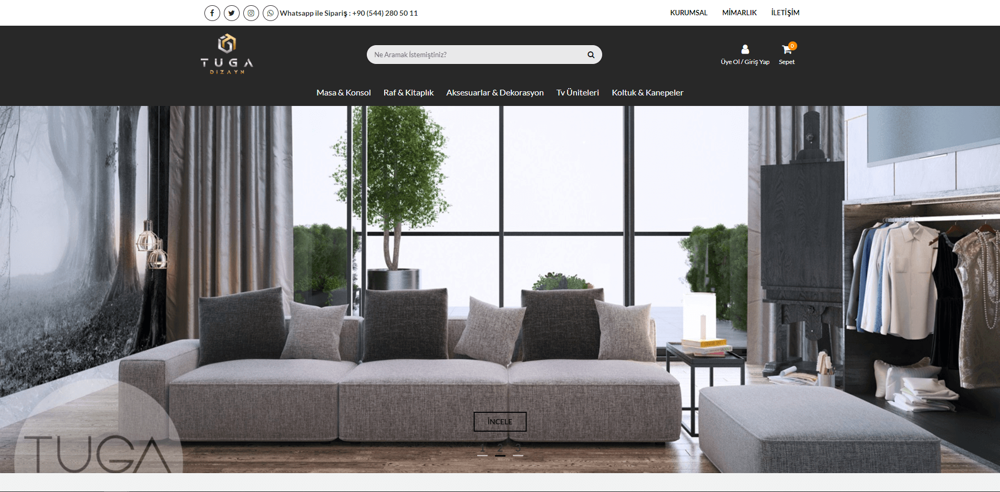
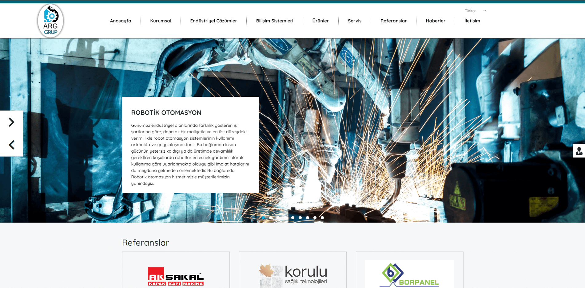
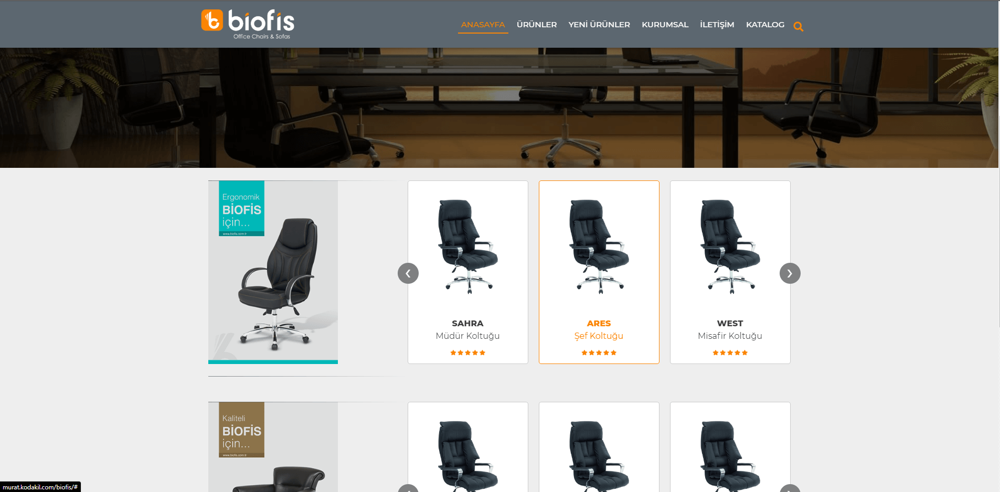
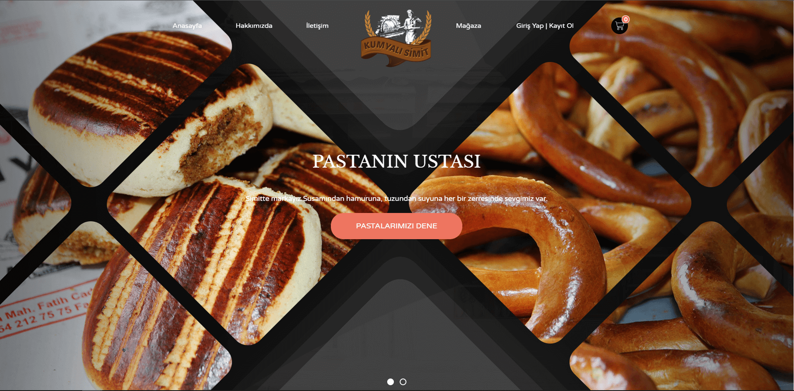
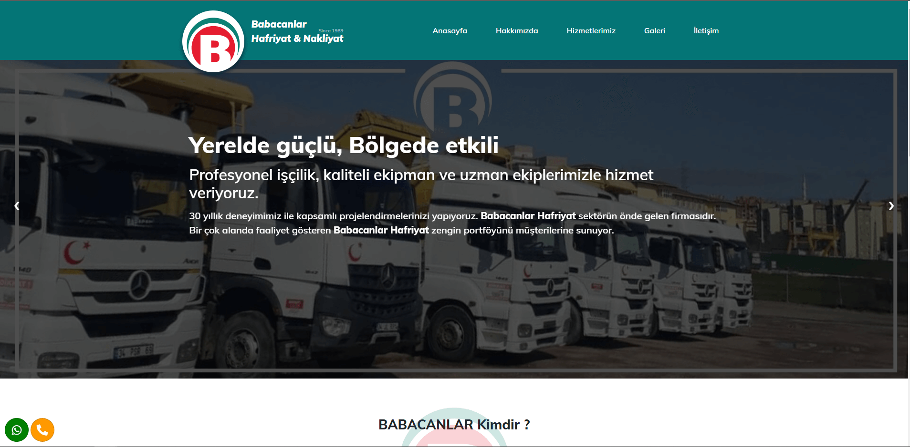
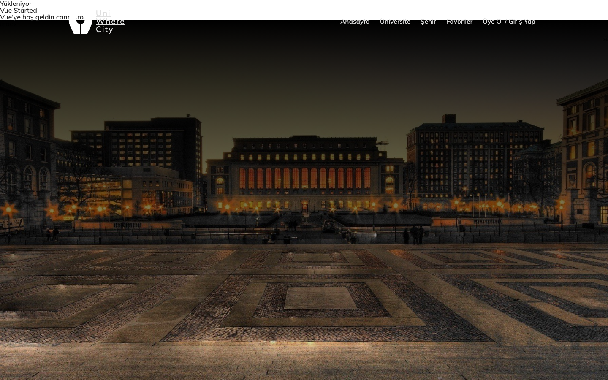
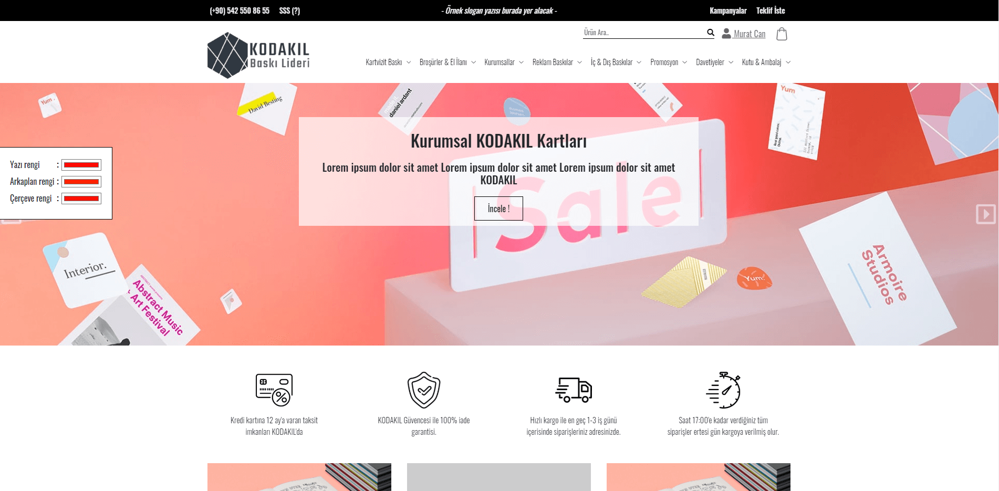
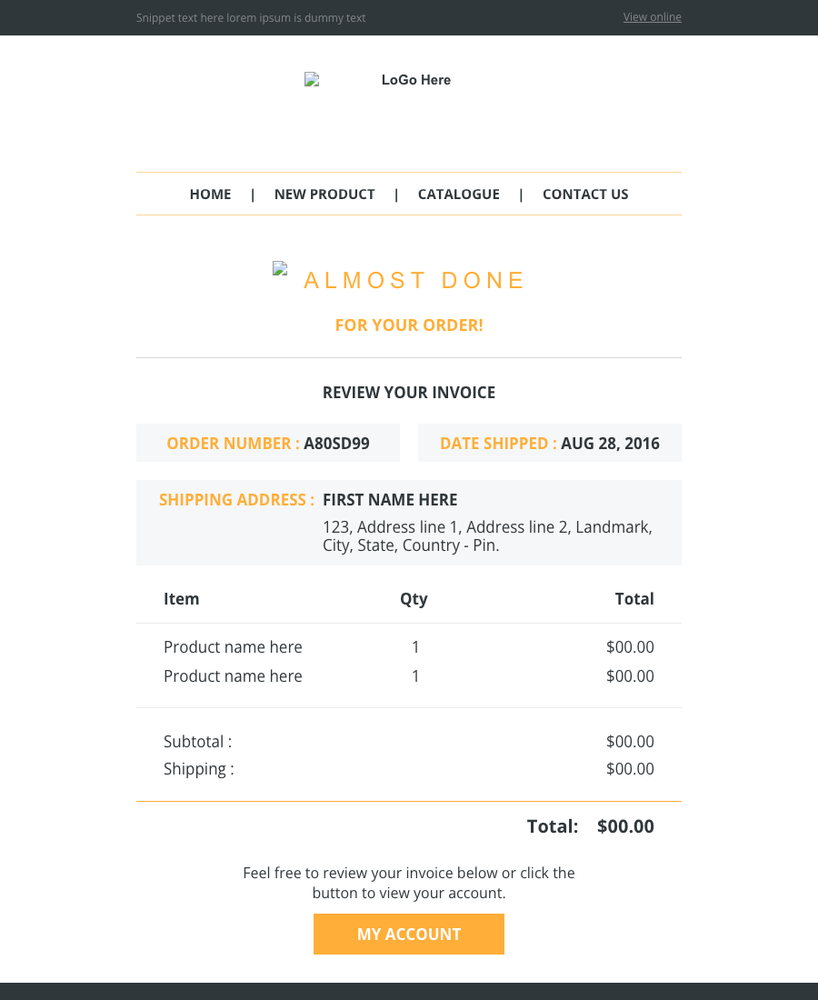
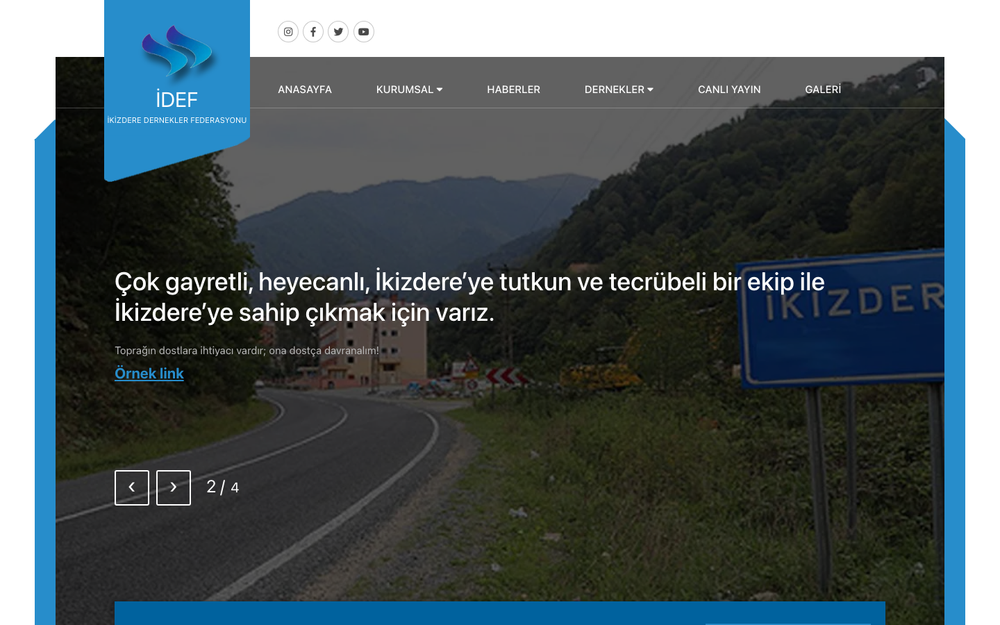

# KODAKIL & Freelance Client Sites — Archive

**Thirteen client websites from my agency and freelance years**: corporate sites, small e-commerce stores, a WordPress theme, a Laravel admin with roles and permissions, and a set of transactional email templates. Each folder is one client, kept as it was delivered.


## Sites

| | Client | What it is | Stack |
|---|---|---|---|
|  | **[Tuga Dizayn](tuga-dizayn)** | Furniture and interior design store: catalogue, product detail, iyzico checkout | CodeIgniter views, jQuery |
|  | **[ARG Grup](arg-grup)** | Industrial automation and robotics company: services, references, contact | PHP, Bootstrap 4.3 |
|  | **[Bi Ofis](bi-ofis)** | Office furniture catalogue with product carousels | PHP, CSS |
|  | **[Kumyalı Simit](kumyali-simit)** | Bakery store: products, cart and payment, orders, profile and dealer sign-up | PHP, Owl Carousel |
|  | **[Babacanlar](babacanlar-excavation)** | Excavation and haulage company: fleet, projects gallery, services | PHP, Dropzone |
|  | **[Aliağa Youth Centre](aliaga-youth-centre)** | Youth centre: courses, teachers, events, shop with PayTR, on the Kodakil CMS | CodeIgniter views, Metronic admin views |
|  | **[Uniwherecity](uniwherecity)** | Single-page landing site rendered with inline Vue | PHP, Vue |
|  | **[E-basım / K01](ebasim-print)** | Print-shop e-commerce: product packages, multi-step cart, quote requests, design tickets, file upload | CodeIgniter views, Swiper |
|  | **[K01 templates](ebasim-print/templates-k01)** | Static front end of the print store: listing, detail, quotes, design, account | PHP templates |
| — | **[Haleia](haleia-wp-theme)** | Custom WordPress + WooCommerce theme (`fm-theme-2020`) with store locator | WordPress, WooCommerce, Bootstrap 4 |
| — | **[UA Yayın admin](ua-yayin-admin)** | Publishing admin: settings, translations, **roles and permissions** | Laravel Blade |
|  | **[Email templates](email-templates)** | Order, registration, password and account emails | Table-based HTML email |
|  | **[İDEF](idef-federation)** | Federation of İkizdere associations: member associations, commissions, live stream, gallery | PHP templates + CodeIgniter views |
|  | **[Vavoldect](vavoldect)** | Creative studio portfolio: animated fingerprint intro, video hero and project pages, in two design directions | HTML, CSS, JS, Plyr |

## Running a site

Most folders are self-contained PHP templates:

```bash
php -d short_open_tag=On -S localhost:8080 -t arg-grup
```

CodeIgniter and Laravel folders contain views only; the applications behind them are not part of this archive.

## Notes

- Credentials and API keys were replaced with environment lookups or placeholders, and personal phone numbers and emails with demo values.
- Uploaded media, videos and commercial themes are not included.

---

<sub>Client work from KODAKIL and freelance projects. Shared for portfolio purposes; no license is granted for reuse.</sub>
